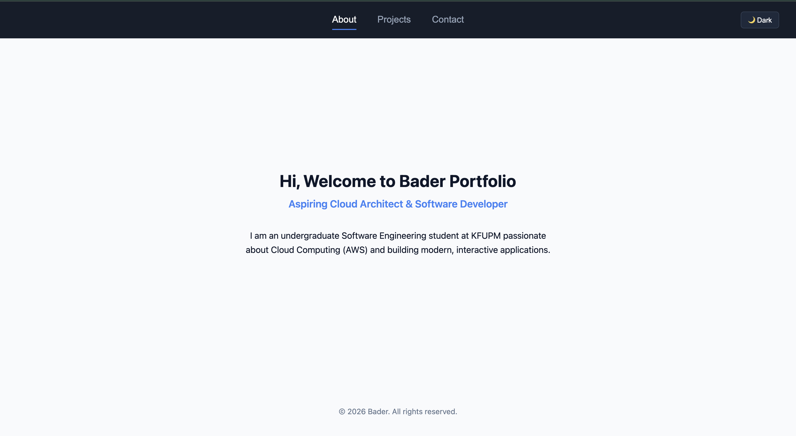

# Bader | Interactive Developer Portfolio (Assignment 2)

**Live demo:** [https://202358650.github.io/REPO-NAME/](https://202358650.github.io/REPO-NAME/)
<!-- TODO: deploy with GitHub Pages (Settings → Pages → Branch: main, folder: / root) and replace REPO-NAME -->


<!-- TODO: take a screenshot of the site and save it as assets/images/screenshot.png -->

---

## 📌 Project Description

This repository contains Assignment 2 of my personal developer portfolio website. It builds on the initial version from Assignment 1 and adds JavaScript interactivity: tab navigation between sections, live project search, a saved light/dark theme preference, and contact form validation with clear user feedback.

---

## ✨ Features

1. **Tab Navigation:** Switches between the **About**, **Projects**, and **Contact** sections without reloading the page, with a fade-in transition.
2. **Live Project Search:** Filters project cards by title and description as the user types. Shows an empty-state message when nothing matches.
3. **Persistent Dark/Light Mode:** Toggles the theme and saves the choice in `localStorage`, so it is restored on the next visit.
   <!-- TODO: only keep "saves in localStorage" if it really does. Test: switch to dark, reload, it should stay dark -->
4. **Contact Form Validation:** Checks for empty fields and a valid email format, then shows an error or a confirmation message.
   <!-- TODO: only list "valid email format" if you added that check -->

---

## 🧭 How to Use

| Feature | How to use it |
|---------|---------------|
| Tabs | Click **About**, **Projects**, or **Contact** in the navigation bar. |
| Search | Open **Projects** and type in the search bar. Cards filter instantly. Clear the box to show all projects. |
| Theme | Click the 🌙 / ☀️ button in the top-right corner. Your choice is remembered. |
| Contact form | Fill in your name, email, and message, then click **Send Message**. Errors appear below the form. |

---

## 🛠 Technologies

- HTML5 (semantic markup)
- CSS3 (Flexbox, transitions, keyframe animations, media queries)
- Vanilla JavaScript (DOM manipulation, event listeners, `localStorage`)
- No frameworks, libraries, or build tools

---

## 📂 Project Structure

```text
assignment-2/
├── README.md
├── index.html
├── css/
│   └── styles.css
├── js/
│   └── script.js
├── assets/
│   └── images/
│       ├── snsCloud.png
│       └── starGame.png
├── docs/
│   ├── ai-usage-report.md
│   └── technical-documentation.md
└── .gitignore
```
<!-- TODO: update this tree if you add images or files -->

---

## 🚀 Setup Instructions (Run Locally)

**Requirements:** a modern web browser (Chrome, Firefox, Safari, or Edge). No installation or build step is needed.

1. Clone the repository:
   ```bash
   git clone https://github.com/202358650/REPO-NAME.git
   ```
2. Go into the project folder:
   ```bash
   cd REPO-NAME
   ```
3. Run the site using **one** of these options:
    - **Option A:** Double-click `index.html` to open it in your browser.
    - **Option B (recommended):** Open the folder in VS Code, install the **Live Server** extension, right-click `index.html`, and choose **Open with Live Server**. The page reloads automatically when you edit files.

---

## 🌐 Browser Compatibility

Tested on:

| Browser / Device | Result |
|------------------|--------|
| Chrome (macOS) | ✅ Works |
| Safari (macOS) | ✅ Works |
| Firefox (macOS) | ✅ Works |
| Mobile view (Chrome DevTools, 375px) | ✅ Works |
<!-- TODO: only list browsers you actually tested -->

---

## 🤖 AI Usage Summary

I used AI tools as a learning and review assistant during this assignment. Claude was used to plan the assignment tasks, review my JavaScript logic for the tabs and search features, and suggest CSS fixes for mobile layout. I wrote or edited all the code myself and tested every feature in the browser.

Full details, including the usage log and declaration, are in [`docs/ai-usage-report.md`](docs/ai-usage-report.md).

---

## 📄 Documentation

- [Technical Documentation](docs/technical-documentation.md): how each feature works internally
- [AI Usage Report](docs/ai-usage-report.md): AI tools, usage log, and declaration

---

## 👤 Author

**Bader Alghamdi**
Student ID: 202358650
Software Engineering, KFUPM
Course: SWE363
